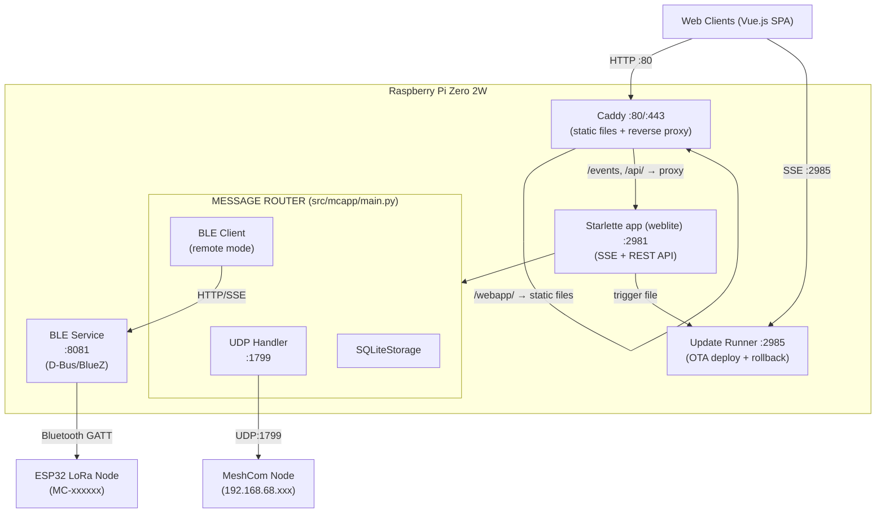
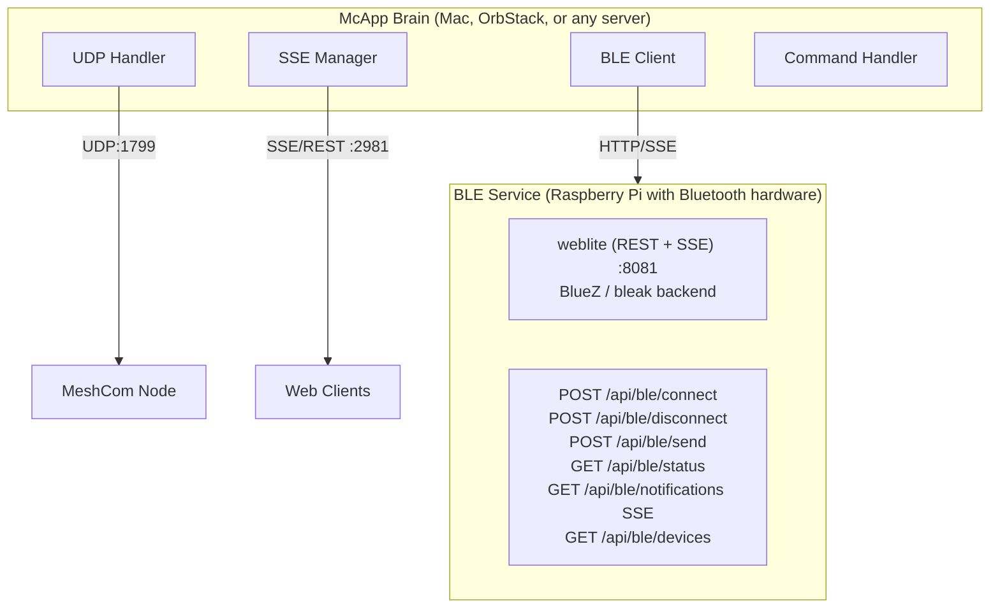
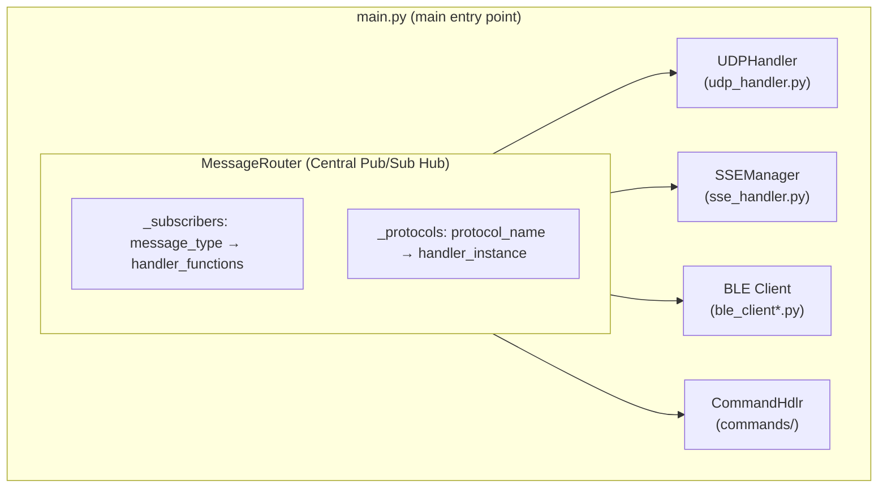

# Architecture Reference

Content preserved from CLAUDE.md — detailed architecture documentation.

## Standard Deployment (Pi with Bluetooth)



## Distributed Deployment (Remote BLE Service)



## Core Components

All source lives in `src/mcapp/`. Entry point: `mcapp.main:run` (invoked via `uv run mcapp`).

- **main.py**: Main entry point. Defines `MessageRouter` (central pub/sub hub) and initializes all protocol handlers
- **sqlite_storage.py**: SQLite storage backend (WAL mode) with cursor-based pagination, type-based retention, composite indexes, and nightly pruning
- **udp_handler.py**: UDP listener/sender for MeshCom node communication (port 1799)
- **sse_handler.py**: SSE/REST API transport (Starlette app built by `_create_app()`, routes via `weblite`; port 2981). Behind Caddy on the LAN front door; lighttpd on 8082 is a backend only on public-TLS boxes. The `StallMiddleware` is the outermost layer (ADR-0007).
- **commands/**: Modular command system using mixin architecture (see Command System section below)
- **config_loader.py**: Dataclass-based configuration with `MCAPP_*` environment variable overrides
- **logging_setup.py**: Centralized logging with `EmojiFormatter`, `get_logger()`, `has_console()` detection
- **meteo.py**: `WeatherService` class — hybrid DWD BrightSky + OpenMeteo weather provider
- **storage/uptime.py**: `UptimeMixin` — gateway-uptime segment ledger. Records arrivals of the `{CET}` time beacon (node uplink → MeshCom server) as an append-only ledger of closed `gap`/`dark` runs; `up` runs are derived by the reader, never stored. Written from a hook in `store_message` that runs **before** `_should_filter_message` (which drops `{CET}`) plus a 30 s heartbeat in `main.py`; read via `GET /api/uptime` (`sse_routes/uptime.py`). See CLAUDE.md's Gateway Uptime section

## BLE Abstraction Layer

The BLE subsystem supports two modes via a unified client interface:

| Mode       | File                     | Description                           |
| ---------- | ------------------------ | ------------------------------------- |
| `remote`   | `ble_client_remote.py`   | HTTP/SSE client to remote BLE service |
| `disabled` | `ble_client_disabled.py` | No-op stub for testing                |

For local BLE hardware access, deploy the standalone BLE service (ble_service/) on the Pi.

- **ble_client.py**: Abstract interface + `create_ble_client()` factory function
- **ble_protocol.py**: Shared protocol decoders/transformers (used by remote client and BLE service)

## BLE Service (Standalone)

Located in `ble_service/` - a Starlette service (FastAPI-compatible names through `weblite`) that exposes BLE hardware via HTTP:

- **ble_service/src/main.py**: REST API + SSE endpoints (on `weblite`)
- **ble_service/src/ble_adapter.py**: Clean D-Bus/BlueZ wrapper class
- **ble_service/mcapp-ble.service**: Systemd service file for Pi

## Message Flow

1. Messages arrive via UDP (from MeshCom node) or BLE (from ESP32)
2. MessageRouter publishes to subscribers based on message type
3. Messages are stored, broadcast to SSE clients, and processed for commands
4. Outbound messages from clients go through suppression logic before mesh transmission

## Key Classes

- `MessageRouter`: Central pub/sub hub connecting all protocols
- `MessageValidator`: Handles message normalization and outbound suppression logic
- `SQLiteStorage`: Persistent storage with WAL mode, pruning, and parallel signal processing
- `BLEClient`: D-Bus based BLE connection with keep-alive and auto-reconnect
- `CommandHandler`: Extensible command system with throttling and abuse protection

## Command System (Mixin Architecture)

The `src/mcapp/commands/` package uses a mixin-based design where `CommandHandler` is assembled from specialized mixins:

- **handler.py** — `CommandHandler` class + `COMMANDS` registry + `create_command_handler()` factory
- **routing.py** — `RoutingMixin`: message reception, intent-based routing to the correct command
- **response.py** — `ResponseMixin`: response delivery back to mesh
- **dedup.py** — `DedupMixin`: duplicate message detection
- **simple_commands.py** — `SimpleCommandsMixin`: `!dice`, `!time`, `!userinfo`
- **data_commands.py** — `DataCommandsMixin`: `!search`, `!stats`, `!mheard`, `!pos`
- **weather_command.py** — `WeatherCommandMixin`: `!wx` / `!weather`
- **admin_commands.py** — `AdminCommandsMixin`: `!kb` (kick-ban), `!topic`
- **topic_beacon.py** — `TopicBeaconMixin`: group beacon management
- **ctcping.py** — `CTCPingMixin`: CTCSS/ping feature
- **constants.py** — Shared constants
- **tests.py** — Built-in test suite (`run_all_tests()`)

## Module Integration

The `MessageRouter` (defined in `src/mcapp/main.py`) is the central pub/sub hub that connects all protocol handlers:



**Initialization Flow** (in `src/mcapp/main.py`, `main()` function):

```python
# 1. Storage — SQLite (with migration) or in-memory deque fallback
if cfg.storage.backend == "sqlite" and SQLITE_AVAILABLE:
    storage_handler = await create_sqlite_storage(...)
else:
    storage_handler = MessageStorageHandler(deque(), cfg.storage.max_size_mb)

# 2. Central router
message_router = MessageRouter(storage_handler)
message_router.set_callsign(cfg.call_sign)

# 3. GPS caching from BLE → updates weather service location
message_router.subscribe("ble_notification", _cache_gps)

# 4. Protocol handlers
command_handler = create_command_handler(message_router, storage_handler, ...)
message_router.register_protocol("commands", command_handler)

udp_handler = UDPHandler(..., message_router=message_router)
message_router.register_protocol("udp", udp_handler)

# 5. SSE manager (REST API + Server-Sent Events), BLE client (local/remote/disabled)
```

**Message Types & Subscriptions:**

| Message Type        | Subscribers                                | Purpose                          |
| ------------------- | ------------------------------------------ | -------------------------------- |
| `mesh_message`      | SSEManager, StorageHandler                 | Messages from LoRa mesh          |
| `ble_notification`  | SSEManager, StorageHandler, CommandHandler | BLE device notifications         |
| `ble_status`        | SSEManager                                 | BLE connection status updates    |
| `websocket_message` | SSEManager (subscribed; no publisher found in `src/mcapp` on 2026-11-10 - candidate for removal)
| `ble_message`       | BLE handler                                | Outbound messages via BLE        |
| `udp_message`       | UDP handler                                | Outbound messages via UDP        |

**Incoming Message Flow (BLE → SSE clients):**

1. BLE device sends GATT notification
2. `BLEClient._on_props_changed()` receives raw bytes
3. `notification_handler()` parses JSON or binary format
4. `message_router.publish('ble', 'ble_notification', data)`
5. `SSEManager._broadcast_handler()` receives via subscription
6. Broadcasts via SSE to all connected clients

**Outgoing Message Flow (Client → Mesh):**

1. Client sends message via `POST /api/send`
2. `SSEManager` routes by type (command, BLE, or UDP message)
3. `message_router.publish('sse', 'udp_message', data)`
4. `MessageRouter._udp_message_handler()` applies suppression logic
5. `UDPHandler.send_message()` sends JSON to MeshCom node

## Node Admin (RM1 remote admin)

Always on (no config switch; LAN-only through a Host/Origin guard) remote administration of other MeshCom nodes over LoRa with HMAC-tagged
`RM1` direct messages. Plan and rationale: `../archive/2026-10-05_1000-node-admin-ui-concept-and-plan.md`.

| Piece                            | Role                                                                                                                                                      |
| -------------------------------- | --------------------------------------------------------------------------------------------------------------------------------------------------------- |
| `remote_cmd.py`                  | Pure core: tags, firmware-exact allowlist and grammar, `{NNN`-aware reply parsing. Pinned to the firmware vectors.                                        |
| `node_admin_service.py`          | Send path, per-target gating, auto-sync, reply correlation, state (`compute_state`). All time injected.                                                   |
| `storage/node_admin.py`          | `NodeAdminMixin`: atomic counter allocation, log, hwm; schema v35 (`node_admin_keys/state/log`).                                                          |
| `sse_routes/node_admin.py`       | `/api/node-admin/*` router with the Host/Origin guard; write-only key route.                                                                              |
| `storage/ingest.py` `reply_hook` | Observe-only seam in `store_message`, before `_should_filter_message`; the service dedups, not the seam.                                                  |
| `main.py` `send_node_admin`      | `TransmitFn` over `_handle_outbound` (same normalisation and TX capture); `_redact_rm1` masks the tag in logs, `send_failed` and failed monitor captures. |
| `node_admin_types.py`            | `NodeAdminService` Protocol, `TransmitFn`, `ReplyHook`, error types (409 busy, 503 unavailable).                                                          |

## Protocol Details

### UDP Message Format

JSON messages with fields: `src`, `dst`, `msg`, `type` (msg/pos/ack), `timestamp`, `rssi`, `snr`

### BLE Binary Messages

- Prefix `D{`: JSON config messages (TYP: MH, SA, G, W, SN, etc.)
- Prefix `@:` or `@!`: Binary mesh messages with header (payload_type, msg_id, hop_count)
- Prefix `@A`: ACK messages

### Chat Commands

All commands start with `!` and are processed by CommandHandler:

- `!wx` / `!weather`: Current weather
- `!mheard` / `!mh`: Recently heard stations
- `!stats`: Message statistics
- `!search`: Search messages by callsign
- `!pos`: Position data lookup
- `!dice`: Roll dice (Mäxchen rules)
- `!time`: Node time
- `!topic`: Group beacon management (admin)
- `!kb`: Kick-ban management (admin)

## Project Directory Structure

```
MCProxy/
├── pyproject.toml           # Project config (hatchling build, uv workspace)
├── uv.lock                  # Locked dependencies
├── config.sample.json       # Configuration template
├── scripts/                 # Release and setup scripts
│   ├── release.sh           # Interactive release builder (gh CLI)
│   ├── update-runner.py     # Standalone OTA update server (port 2985)
│   └── (ssl-tunnel-setup.sh lives in bootstrap/, not scripts/)
│
├── src/mcapp/               # Main Python package
│   ├── __init__.py          # Version export (__version__)
│   ├── main.py              # Entry point + MessageRouter
│   ├── config_loader.py     # Dataclass-based configuration
│   ├── logging_setup.py     # Centralized logging + EmojiFormatter
│   ├── sqlite_storage.py    # SQLite storage backend (WAL mode)
│   ├── udp_handler.py       # UDP protocol handler
│   ├── sse_handler.py       # SSE/REST API transport (Starlette via weblite, port 2981)
│   ├── meteo.py             # WeatherService (DWD + OpenMeteo)
│   ├── ble_client.py        # BLE abstraction interface + factory
│   ├── ble_client_remote.py # Remote BLE (HTTP/SSE)
│   ├── ble_client_disabled.py # No-op stub
│   ├── ble_protocol.py      # Shared BLE protocol decoders/transformers
│   └── commands/            # Modular command system (mixin-based)
│       ├── __init__.py
│       ├── handler.py       # CommandHandler + COMMANDS registry
│       ├── routing.py       # RoutingMixin
│       ├── response.py      # ResponseMixin
│       ├── dedup.py         # DedupMixin
│       ├── simple_commands.py
│       ├── data_commands.py
│       ├── weather_command.py
│       ├── admin_commands.py
│       ├── topic_beacon.py
│       ├── ctcping.py
│       ├── constants.py
│       └── tests.py         # Built-in test suite
│
├── ble_service/             # Standalone BLE service (uv workspace member)
│   ├── src/
│   │   ├── __init__.py
│   │   ├── main.py          # REST + SSE (weblite)
│   │   └── ble_adapter.py   # Clean D-Bus wrapper
│   ├── pyproject.toml
│   ├── mcapp-ble.service    # Systemd service
│   └── README.md            # API documentation
│
├── bootstrap/               # Installation scripts
│   ├── mcapp.sh             # Main entry point
│   ├── DEPLOYMENT_LOGGING.md # Deployment logging guide
│   ├── README.md            # Installation documentation
│   ├── lib/                 # Script modules
│   └── templates/           # Config templates (incl. caddy/, cloudflared/)
│
└── doc/                     # Documentation: see doc/README.md (index and layers)
    ├── adr/                 # Architecture decisions (ADR-NNNN)
    ├── policy/              # Rules that must hold (POL-NNN)
    ├── sop/                 # Procedures (SOP-NNN)
    ├── runbook/             # Commands and paths (RB-NNN)
    ├── reference/           # Stable technical reference (this folder)
    ├── plans/               # Open plans and concepts
    ├── archive/             # Closed work, superseded documents
    ├── backlog.md           # Deferred work (B-items)
    ├── tech-debt.md         # Refactoring candidates
    ├── ops-mcapp-health-log.md  # Production health log
    ├── release-history.md   # Release notes (newest first)
    └── review-log.md        # Verification runs and owner questions
```

## Ports and processes (checked 2026-11-10)

| Port | Process | Exposed | Source |
|------|---------|---------|--------|
| 80, 443 | Caddy (LAN template; TLS template on public boxes) | LAN / internet | `bootstrap/templates/caddy/` |
| 1799/udp | MeshCom Extern-UDP, both directions | LAN | `config_loader.py` (`MESHCOM_UDP_PORT`, not configurable) |
| 2981 | McApp API (`SSE_PORT`) | loopback, proxied by Caddy | `config_loader.py`, `sse_handler.py` |
| 2985 | Update runner (stdlib HTTP) | LAN | `scripts/update-runner.py` |
| 8081 | BLE service | loopback | `config_loader.py` (`BLE_SERVICE_URL`), `ble_service/src/main.py` |
| 8082 | lighttpd backend (public-TLS boxes; B15 removes it) | loopback | `bootstrap/templates/lighttpd.conf` |
| 19532 | Journal upload (AIOps cross-shipping) | LAN only | `bootstrap/lib/system.sh` |

## Web layer

The API is Starlette through `src/mcapp/weblite.py`, not FastAPI. `weblite` implements only what the routes use and
raises `TypeError` at registration for anything else. The BLE service carries a byte-identical copy. Reasons: ADR-0006.
Route tables are checked by `route_table_tests`, which builds the real `_create_app()`.

## Testing

Suites are `*_tests.py` modules, registered in `main()` of `scripts/run_startup_tests.py`. An unregistered suite is not
gated. The in-app startup runs only a non-fatal smoke check. Reasons: ADR-0016. The gate that runs all of it:
`scripts/gate.sh` (POL-001).

## Blocklist

`sperrliste.json` from `main` (not `development`) is fetched every 15 minutes with a conditional GET and merged with local
kickbans. Filtering happens on the way out of storage, so an entry is retroactive. Reasons: ADR-0012. Vector corpus:
`blocklist_decision_vectors.json` (webapp copy pinned).

## Dependencies

The authoritative lists are `pyproject.toml` (`[project] dependencies`) and `ble_service/pyproject.toml`.
Checked 2026-11-10. Notable choices, each with its reason in the file:

- **No FastAPI** in the main package: `starlette`, `uvicorn`, `sse-starlette`, `pydantic`. Routes use `src/mcapp/weblite.py` (ADR-0006).
- **No pywebpush**: `http-ece` and `py-vapid` for the crypto, `httpx` for the POST (ADR-0013).
- `uvloop` and `httptools` are listed explicitly instead of the `uvicorn[standard]` extra (memory).
- `timezonefinder` is imported only by the short-lived `tz_lookup_worker.py` child (memory, ADR-0006 context).
- `ble_service` depends on `dbus-next` (BlueZ) and, on macOS only, `bleak` (CoreBluetooth backend).

System packages (installed by the bootstrap, see RB-009): `caddy` (front door, LAN and TLS), `lighttpd` (backend on
127.0.0.1:8082, public-TLS boxes; to be removed, `backlog.md` B15), `bluez` (BLE service), `jq` (shell scripts).
