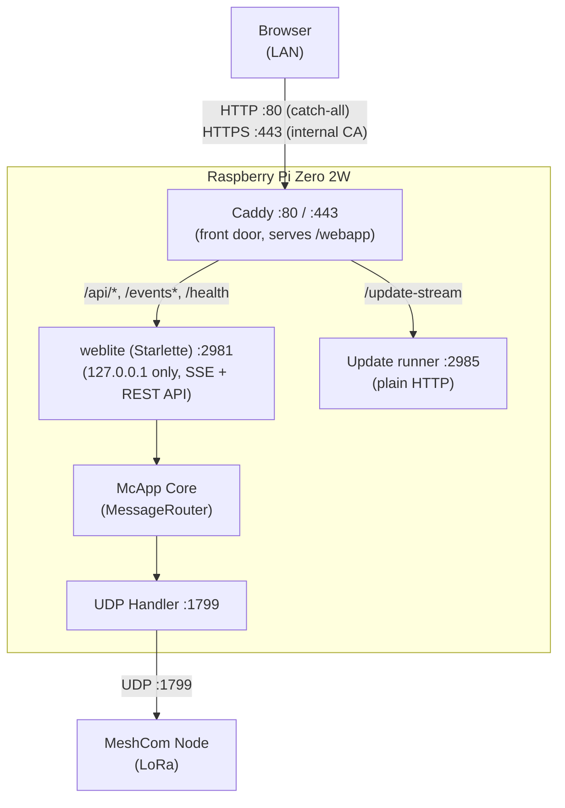
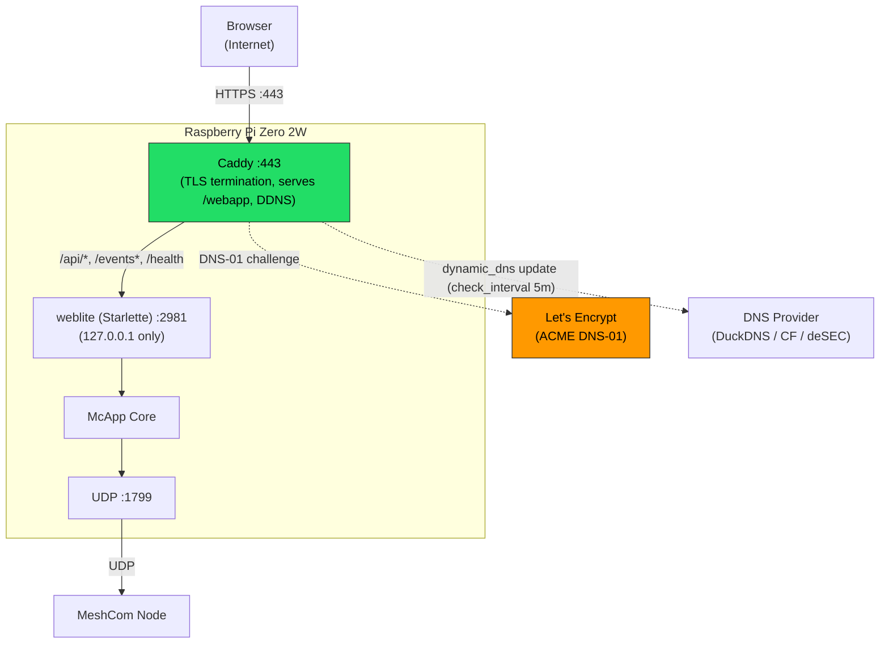
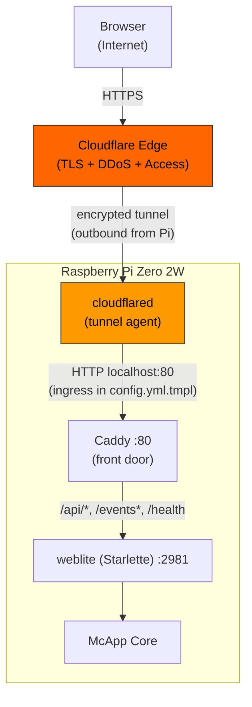
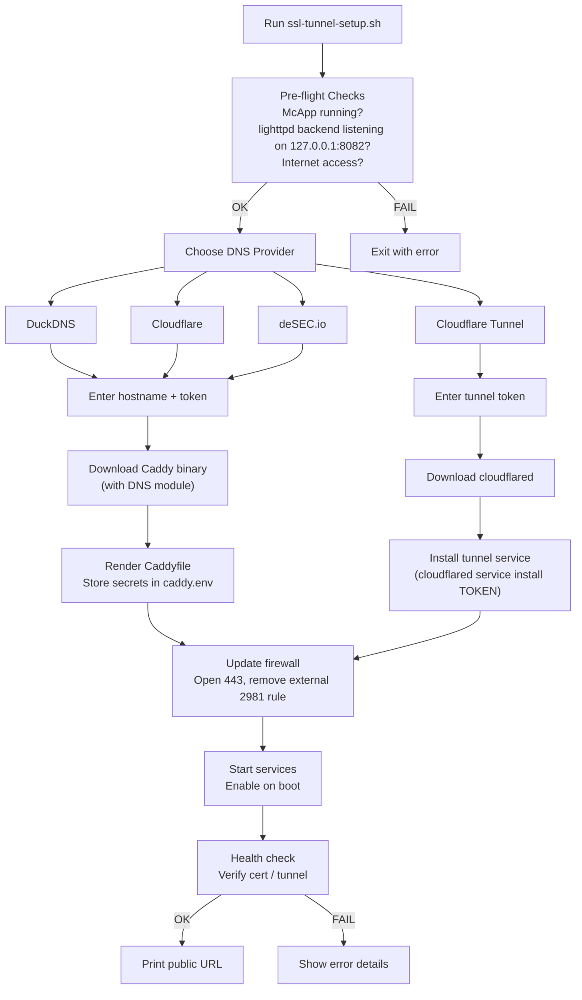
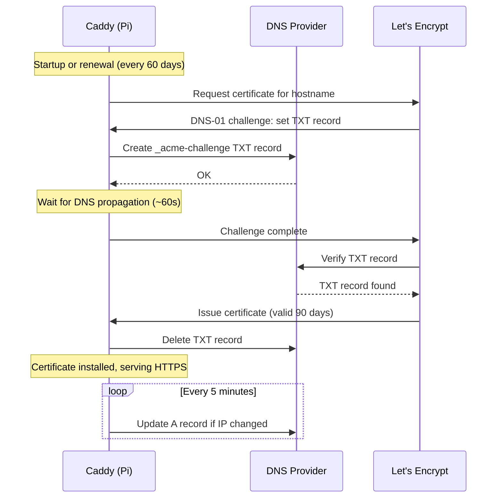

# TLS Remote Access Architecture

> **Verifiziert 2026-11-10** gegen `bootstrap/templates/caddy/Caddyfile.mcapp`, `Caddyfile.duckdns.tmpl`,
> `Caddyfile.desec.tmpl`, `Caddyfile.cloudflare.tmpl`, `bootstrap/templates/cloudflared/config.yml.tmpl`,
> `bootstrap/ssl-tunnel-setup.sh`, `src/mcapp/sse_handler.py` (`DEFAULT_SSE_PORT`), `src/mcapp/config_loader.py`
> (`SSE_HOST`, `SSE_PORT`, `MESHCOM_UDP_PORT`) und `bootstrap/templates/mcapp-ble.service`.
> Die Diagramme waren bis hierher FastAPI/lighttpd als Front-Door dargestellt; korrigiert auf den Stand seit
> 2026-11-05: **Caddy ist die Front-Door** (`:80`/`:443`), liefert `/webapp` selbst und reicht `/api/*`,
> `/events*` und `/health` direkt an **weblite** (Starlette, `src/mcapp/weblite.py`) auf `127.0.0.1:2981` durch.
> **lighttpd** bleibt auf `127.0.0.1:8082` installiert, steht in den aktuellen Caddyfiles aber nicht mehr im
> Anfragepfad; nur Caddyfiles aus einem älteren `mcapp.sh` proxien noch dorthin (Legacy).

## Ports (Stand 2026-11-10)

| Port               | Proto | Bind          | Owner                          | Role                                                |
| ------------------ | ----- | ------------- | ------------------------------ | --------------------------------------------------- |
| 80, 443            | TCP   | all           | Caddy                          | Front door (LAN-HTTPS default, or public TLS)       |
| 443                | UDP   | all           | Caddy                          | QUIC / HTTP/3                                       |
| 2981               | TCP   | 127.0.0.1     | mcapp (weblite, SSE + REST)    | API behind Caddy                                    |
| 2985               | TCP   | 0.0.0.0 (see note) | update runner (`scripts/update-runner.py`) | `/update-stream` progress, behind Caddy; open in nftables |
| 8081               | TCP   | 127.0.0.1     | ble_service (uvicorn)          | BLE service, called by mcapp                        |
| 8082               | TCP   | 127.0.0.1     | lighttpd                       | Legacy backend (see note above)                     |
| 1799               | UDP   | all           | mcapp                          | MeshCom node communication (Extern-UDP)             |

## Diagram 1: Base Setup (LAN, internal CA — no public DNS)

The `:80` block is a catch-all with no redirect to HTTPS, so every name a LAN client uses (`.local`,
`.fritz.box`, bare IP) gets the site. `:443` answers the `.local`/`.fritz.box`/`.home.arpa`/`.lan`/`.home`
names with a certificate from Caddy's internal CA (`/root.crt` serves the root).

## Diagram 2: TLS Setup (Caddy + Let's Encrypt)

Note on 2985: the Caddy templates describe the update runner as `127.0.0.1:2985`, but `scripts/update-runner.py`
binds `0.0.0.0:2985` (line 1294, "LAN service binds all interfaces by design"), and the firewall opens 2985.
The code is the source of truth here; the template comments are the stale part.

The public-TLS templates (`Caddyfile.duckdns.tmpl`, `.cloudflare.tmpl`, `.desec.tmpl`) replace the LAN
default Caddyfile and proxy straight to `127.0.0.1:2981`. Their comments still describe lighttpd as
"legacy and no longer proxied" — they are consistent with this diagram.

## Diagram 3: Cloudflare Tunnel Alternative

`config.yml.tmpl` routes the tunnel to `http://localhost:80`, which is Caddy (it was lighttpd before
2026-11-05). `ssl-tunnel-setup.sh` installs the tunnel with `cloudflared service install <token>`, so the
ingress that is actually live is set in the Cloudflare dashboard and is not verifiable from the repo.

## Diagram 4: ssl-tunnel-setup.sh Flow

The pre-flight in `ssl-tunnel-setup.sh` still requires lighttpd to listen on `127.0.0.1:8082` (it says
"now the backend behind Caddy"), while the templates no longer proxy to it. That mismatch is an open
item in the script, not in this document.

## Diagram 5: Certificate Lifecycle

The 60-day renewal interval is Caddy's own default behaviour, not a McApp setting. Not verified against a live
certificate in this review.
